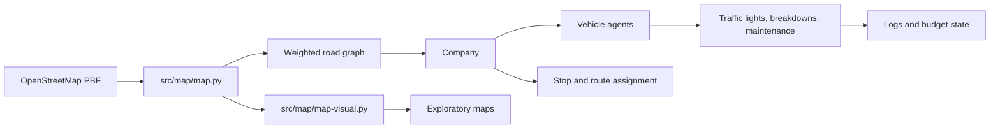

# Urban Mobility Optimization Simulation

An academic Python prototype for modelling urban transport operations in Havana, Cuba. The project combines a real OpenStreetMap road network with vehicle, passenger-demand, traffic-light, maintenance, and route-assignment models.

> **Project status:** research prototype. The repository contains the simulation domain model and map-processing experiments, but it does not currently provide a single turnkey command that runs a complete 24-hour experiment or exports benchmark metrics.

## Why this project matters

Urban transport operators must assign limited vehicle capacity to passenger demand while dealing with route distance, traffic lights, breakdowns, maintenance, fuel cost, and budget constraints. This project explores those decisions with a multi-agent model that can be extended for transport planning experiments.

## Current capabilities

- Models transport vehicles, a transport company, traffic lights, stops, routes, passenger demand, maintenance, breakdowns, fuel costs, fines, and budget state.
- Loads a drivable road network from an OpenStreetMap `.osm.pbf` extract with **Pyrosm**.
- Uses **NetworkX** weighted shortest paths to expand stop sequences into road-level routes and to support rerouting.
- Contains route-assignment hooks for simulated annealing and ant-colony optimisation.
- Includes exploratory map visualisation and geocoding code in `src/map/map-visual.py`.

The implementation is intentionally preserved as a prototype: several optimisation and planning symbols referenced by `src/ia/agents.py` are not defined in the current repository, so those paths should be treated as extension points rather than advertised as a complete executable pipeline.

## Architecture



### Main components

| Component | Responsibility |
| --- | --- |
| `Vehicle` | Tracks capacity, position, route progress, passengers, distance, speed, failures, and maintenance state. |
| `Semaphore` | Simulates green, amber, and red phases with randomised cycle lengths. |
| `Company` | Assigns vehicles and stops, starts routes, accounts for income and fuel, checks maintenance, and manages replacements. |
| `src/map/map.py` | Creates a Pyrosm road-network view for a Havana bounding box. |
| `src/map/map-visual.py` | Exploratory GeoPandas, Matplotlib, Folium, and Nominatim experiments. |

## Algorithms and modelling choices

- **Weighted shortest path:** NetworkX Dijkstra-style shortest paths convert stop sequences into traversable road-node routes and support temporary edge avoidance during rerouting.
- **Ant colony optimisation hook:** `Company.__get_route_of_vehicles()` calls `AntColony` to choose an order for assigned stops. The referenced implementation is not included in the current tracked source.
- **Simulated annealing hooks:** vehicle-to-client and stop-to-vehicle assignment call `SimulatedAnnealingVehiclesToClients` and `SimulatedAnnealingRouteToVehicle`. Their implementations are also not included in the current tracked source.
- **Agent-based state transitions:** vehicles and the company update operational state over time, including passenger loading, unloading, traffic-light waiting, breakdowns, maintenance, replacement, and financial accounting.

These descriptions distinguish implemented domain behaviour from referenced extension points so the repository remains technically accurate.

## Data sources

- **Road network:** OpenStreetMap data distributed as a Cuba extract by [Geofabrik](https://download.geofabrik.de/central-america/cuba.html). A PBF extract is currently checked into `src/map/cuba-map/`.
- **Population context:** The original thesis context cites ONEI Cuba's *Estudio y Datos de Población 2023*. No demographic input file is currently included in this repository; passenger demand must therefore be supplied by a caller or future data-ingestion layer.
- **Geocoding experiments:** `src/map/map-visual.py` uses the public Nominatim service. Respect its usage policy and configure a descriptive user agent for any repeated or production use.

## Setup

Python 3.10+ is recommended. Create an isolated environment and install the pinned top-level dependencies:

```bash
python -m venv .venv
# Windows PowerShell
.venv\Scripts\Activate.ps1
# macOS/Linux
source .venv/bin/activate
python -m pip install --upgrade pip
python -m pip install -r requirements.txt
```

`pyrosm` and its geospatial dependencies may require platform-specific wheels or build tools. If installation fails, use a compatible Python version and follow the package installation guidance for your operating system.

The checked-in PBF is large. For a fresh or smaller checkout, download the Cuba extract from Geofabrik and place it at `src/map/cuba-map/cuba-latest.osm.pbf`.

## Running and validating

There is no single application entry point yet. The code can be imported and syntax-checked as follows:

```bash
python -m py_compile file.py src/ia/agents.py src/map/map.py src/map/map-visual.py
```

Before using `src/map/map.py` on a new machine, update its `pbf_file_path` to the local PBF location. The current source retains the original thesis workstation path for backwards compatibility.

For a complete experiment, a future runner should construct a NetworkX graph, map demand to stop objects, instantiate `Vehicle` and `Company`, advance simulation time, and export metrics such as passenger throughput, vehicle-kilometres, average waiting time, maintenance events, fuel cost, and ending budget.

## Results and reproducibility

No benchmark dataset, experiment configuration, or generated metric table is currently committed, so this repository does not make quantitative performance claims. Reproducible evaluation is a clear next step: fix random seeds, version the demand scenario, record algorithm parameters, and export machine-readable results for each run.

## Limitations and next steps

- Add a maintained executable runner and scenario configuration format.
- Implement or vendor the optimisation and planning classes currently referenced by `agents.py`.
- Replace hard-coded local paths with command-line or environment configuration.
- Add deterministic seeds, unit tests for accounting and route transitions, and integration tests on a small fixture graph.
- Add demand data with documented provenance and privacy considerations.
- Record benchmark outputs and compare routing strategies against simple baselines.
- Separate exploratory notebook-style scripts from reusable library code.

## Technologies

**Python · NetworkX · NumPy · Pyrosm · GeoPandas · Pandas · Folium · Matplotlib · Geopy · Osmium**

## Best-fit roles

This project is a strong portfolio example for **Data Scientist**, **Operations Research / Optimization Engineer**, **Machine Learning Engineer (simulation and planning)**, **Urban Mobility Analyst**, and **Python Research Engineer** roles. It is most compelling when discussed as an algorithmic prototype and research foundation, rather than as a production-ready transport platform.
